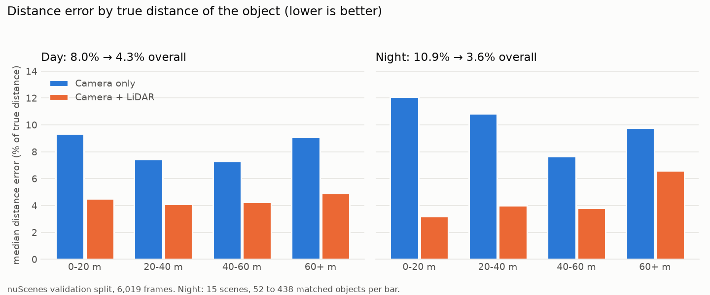
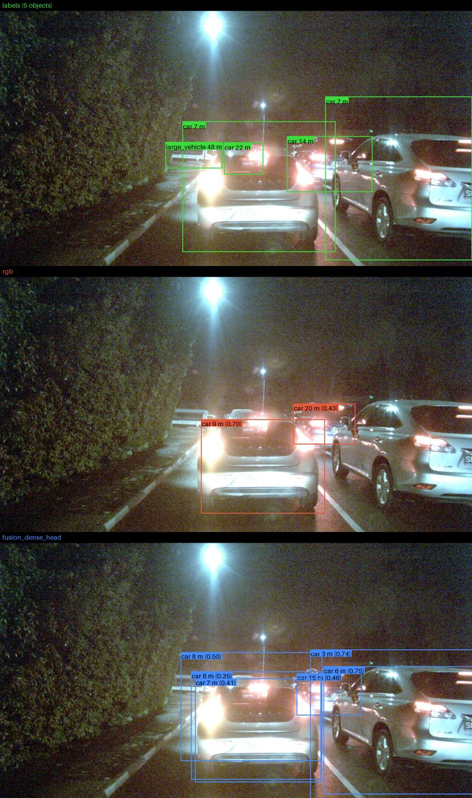

# Night-time Camera + LiDAR Fusion

[](https://github.com/kovarthanmuthusamy/Sensor-fusion/actions/workflows/ci.yml)


**Does LiDAR help a camera detector in the dark, and by how much?** I trained a single network that finds road users and estimates how far away each one is, first from the front camera alone and then with projected LiDAR, evaluated both with proper uncertainty on nuScenes, and shipped the result as an ONNX model behind an API, a CPU container and a demo.

- **Result:** LiDAR roughly **halves the distance error** (8.1% → 4.3%; at night 10.9% → 3.6%, intervals exclude zero). Box precision improves too; finding objects overall does not change, and a night detection gain is likely but not established.
- **Honest process:** the first LiDAR model was *no better* than the camera model. I traced it to an input that was 99% empty, fixed it, and chose the final design with a pre-registered experiment ([the story](docs/learning/008-dense-depth-input.md)).
- **Production path:** ONNX export with a parity check; a FastAPI service with readiness and liveness probes, Prometheus metrics, structured logs with request IDs, bounded concurrency with load shedding and input limits; a non-root CPU container with a CI build-and-smoke-test job; a runbook. A whole call takes **59 ms** (camera) / **112 ms** (fusion) on CPU.
- **Stack:** PyTorch, ONNX Runtime, FastAPI, Docker, Hydra, Weights & Biases, GitHub Actions, pytest (372 tests), mypy, ruff.

<p align="center"></p>

## Demos
**1. Side-by-side demo** (Gradio, local): pick a day or night validation frame and compare the labels, the camera-only model and the fusion model, with the distance printed on each box.
```bash
python -m sensor_fusion.serve.demo --model rgb=outputs/serve/rgb --model fusion=outputs/serve/fusion_dense_head
```
<p align="center"></p>

On this night frame (labels, camera only, camera + LiDAR, top to bottom), the car labelled 14.1 m is placed at 20.3 m by the camera and at 14.6 m with LiDAR:

| object | true distance | camera only | camera + LiDAR |
|---|---|---|---|
| car | 6.6 m | missed | 6.4 m |
| car | 6.8 m | 8.5 m | 8.1 m |
| car | 14.1 m | 20.3 m | 14.6 m |
| car | 21.7 m | missed | missed |
| large vehicle | 48.3 m | missed | missed |

It also shows a weakness, kept on purpose: big close objects get two or three overlapping boxes (no non-maximum suppression yet) and the distant objects are missed by both models ([more failure cases](docs/failure_cases.md)).

**2. The API** (what a customer would call): a photo, the raw LiDAR points and the calibration go in, boxes with class, score and distance come out. Bad input gets a 422 with a reason, never a crash.
```bash
python -m sensor_fusion.serve.app --model-dir outputs/serve/fusion_dense_head --port 8000
curl -F image=@photo.png -F lidar=@points.npy -F "calibration=<calibration.json" \
     -F score_threshold=0.5 http://localhost:8000/detect
```
```json
{"model": "fusion_dense_head",
 "detections": [
   {"class_name": "car", "score": 0.75, "box": [1096, 455, 1616, 887], "distance_m": 6.4},
   {"class_name": "car", "score": 0.74, "box": [1051, 397, 1662, 913], "distance_m": 6.2},
   {"class_name": "car", "score": 0.50, "box": [612, 406, 1092, 775], "distance_m": 8.1}],
 "timings_ms": {"prepare_ms": 85, "network_ms": 28, "decode_ms": 3, "total_ms": 117},
 "request_id": "02e5b2ee855145b5b9d3d36b49bb6f0f"}
```
(Real output for the frame above; the first two boxes are one car. `request_id` is the same ID that appears in the service's log line and the `X-Request-ID` header; it comes from a second call of the same service. Under load the service holds about 10 requests/s on CPU and answers 503 beyond its queue: [load test](docs/load_test.md).) `points.npy` is a float32 `(N, 3+)` array in the LiDAR frame; `calibration.json` holds `T_cam_from_lidar` (4×4, including the vehicle's motion between scan and photo) and `intrinsic` (3×3).

**3. The container** (CPU image, model mounted from outside; the `serve-container` CI job is set up to build it and send it a real request; there is no Docker on my lab machine, so I could not run it locally):
```bash
docker build -t sensor-fusion-serve .
docker run -p 8000:8000 -v "$PWD/outputs/serve/fusion_dense_head:/models:ro" sensor-fusion-serve
```
*Images: nuScenes (Motional), CC BY-NC-SA 4.0, used here to show results; research use only.*

## Results
Camera only vs the final model on the 6,019 validation frames (150 scenes). Brackets are 95% intervals from a bootstrap over **scenes** (frames of one scene are near-duplicates). Everything, including an ablation and a second checkpoint: [`docs/results/`](docs/results/README.md); model card: [`docs/MODEL_CARD.md`](docs/MODEL_CARD.md).

| | camera only | camera + LiDAR | difference |
|---|---|---|---|
| median distance error, all | 8.1% | **4.3%** | -3.8 pts [-4.2, -3.4] |
| median distance error, night | 10.9% | **3.6%** | -7.3 pts [-8.3, -5.4] |
| box precision (mAP@[0.5:0.95]), night | 16.4 | 19.9 | +3.5 [1.8, 5.3] |
| finding objects (mAP@0.5), all | 51.2 | 51.0 | -0.2 [-2.4, 1.9] |
| finding objects (mAP@0.5), night | 41.4 | 44.0 | +2.6 [-2.2, 8.0] |

The ablation credits the depth path into the network's heads with the distance gain, and the dense LiDAR input with the night detection gain (+7.2 [2.3, 10.7] on its own); the final model's night gain is +2.6 at its best epoch and +7.1 at its last, so I call it likely, not proven.

## What this project demonstrates
| | evidence in the repo |
|---|---|
| **Multi-sensor fusion & AV domain** | LiDAR→camera projection with both vehicle poses, 3D→2D labels with distance, sparse-depth handling (thickening, validity mask), day/night and location confound analysis ([ADR 0004](docs/adr/0004-data-pipeline-choices.md), [0008](docs/adr/0008-location-confound-in-day-night.md)) |
| **ML engineering** | custom centre-based detector with a distance head, focal + L1 loss, fp16 on Volta, scene-level splits, overfit-one-batch checks, safeguards against leakage and NaNs ([ADR 0006](docs/adr/0006-detector-input-and-targets.md), [0009](docs/adr/0009-network-and-loss.md), [0010](docs/adr/0010-training-setup.md)) |
| **Rigorous evaluation** | own COCO-style mAP verified against pycocotools, paired bootstrap over scenes, a reporting rule fixed before the results, per-range distance error ([ADR 0011](docs/adr/0011-evaluation-reporting-rules.md), [0012](docs/adr/0012-evaluation-protocol.md)) |
| **Debugging & scientific method** | fusion = baseline → measured the input → fix → pre-registered experiment → ablation ([log 008](docs/learning/008-dense-depth-input.md), [ADR 0013](docs/adr/0013-dense-depth-and-retrain-protocol.md)) |
| **Deployment** | ONNX export with parity check, API with input validation, training-serving skew test, lean container, latency profiling that found a 3× thread-oversubscription slowdown ([ADR 0007](docs/adr/0007-serving-and-demo.md), [log 009](docs/learning/009-serving.md), [benchmarks](docs/benchmarks.md)) |
| **Operating a service** | settings from the environment, JSON logs with request IDs, `/ready` vs `/health`, `/metrics`, load shedding (503 + `Retry-After`), size and point limits that act before parsing, generic 500s, non-root read-only container, load test, runbook, security notes ([ADR 0014](docs/adr/0014-production-hardening.md), [runbook](docs/RUNBOOK.md), [SECURITY.md](SECURITY.md)) |
| **Engineering practice** | Hydra configs, seeds, W&B tracking, pre-commit, mypy, CI, an ADR for every real decision, a learning log of every error |

## Operating the service
Built to be run by someone else, not just to work on my machine ([ADR 0014](docs/adr/0014-production-hardening.md)):

| | what is there | where |
|---|---|---|
| **Observability** | one JSON log line per request with a request ID that is also returned in `X-Request-ID`; Prometheus metrics for requests, latency, stages, load and rejections; photos and LiDAR points are never logged | `/metrics`, [runbook](docs/RUNBOOK.md) |
| **Reliability** | `/health` (alive) separate from `/ready` (model warm); inference off the event loop; at most `SF_MAX_CONCURRENT` detections at once plus a short queue, then a fast 503 with `Retry-After`; graceful shutdown | [load test](docs/load_test.md) |
| **Safety** | size check before the body is parsed, LiDAR point cap, image header checked before decoding, no pickle loading, generic 500s with the details only in the log, non-root container with a read-only filesystem and no capabilities | [SECURITY.md](SECURITY.md) |
| **Process** | `make help` lists every task; CI runs lint, types, tests and builds and smoke-tests the container; Dependabot; ADR for every decision; changelog; contributing guide | [CONTRIBUTING.md](CONTRIBUTING.md), [CHANGELOG.md](CHANGELOG.md), [docs index](docs/README.md) |

## Quick start
Requires Python 3.11; training used an NVIDIA GPU (Quadro GV100), serving and evaluation run on CPU. nuScenes needs a free registration at nuscenes.org and is not included: extract `samples/CAM_FRONT` and `samples/LIDAR_TOP` (34,149 files each) and the metadata into `dataset/v1.0-trainval/`.
```bash
python3.11 -m venv .venv && source .venv/bin/activate          # Windows: .venv\Scripts\activate
pip install torch==2.14.1 torchvision==0.29.1 --index-url https://download.pytorch.org/whl/cu126
pip install -e ".[dev,serve,demo]" && pre-commit install

CUDA_VISIBLE_DEVICES=0 python -m sensor_fusion.train data=trainval model=rgb seed=42 trainer.epochs=8
CUDA_VISIBLE_DEVICES=1 python -m sensor_fusion.train data=trainval model=fusion_dense_head seed=42 trainer.epochs=8
python -m sensor_fusion.evaluate baseline=<rgb best.pt> fusion=<fusion best.pt>       # results.md + results.json
python -m sensor_fusion.serve.export <fusion best.pt> outputs/serve/fusion_dense_head  # ONNX + parity check
```
Exact development versions: [`requirements.lock.txt`](requirements.lock.txt). Checks: `pre-commit run --all-files`, `mypy`, `pytest --cov` (GPU and dataset tests skip themselves when not available).

## Limits, stated plainly
- **Night means Singapore, and one neighbourhood:** all 99 night scenes in nuScenes trainval are Singapore; the 15 validation night scenes are Holland Village. Pedestrians (32) and large vehicles (46) at night have too few labels to score.
- **One seed per model**, and the best epoch was chosen on the reported validation split (the test split was never used).
- **Front camera only, 4 merged classes, 2D boxes:** not comparable with the nuScenes leaderboard.
- **No non-maximum suppression** (duplicate boxes), and the service trusts the calibration it is given and accepts only 1600×900 photos.
- The weights derive from nuScenes (CC BY-NC-SA 4.0): research use only.

## How this was built
I made and recorded the design decisions; an AI coding agent (Claude Code) wrote and tested the code under a review-every-diff workflow ([`CLAUDE.md`](CLAUDE.md)). [`docs/adr/`](docs/adr/) holds every decision and [`docs/learning/`](docs/learning/) what was built, which errors were hit and what each taught.

## License
Code: [MIT](LICENSE). nuScenes is licensed separately (CC BY-NC-SA 4.0, non-commercial).
