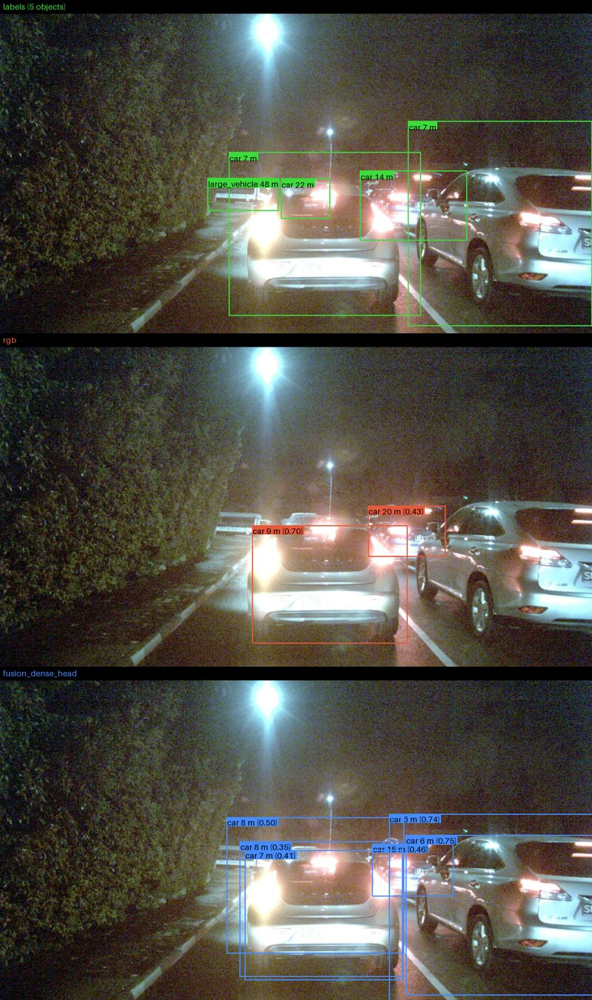
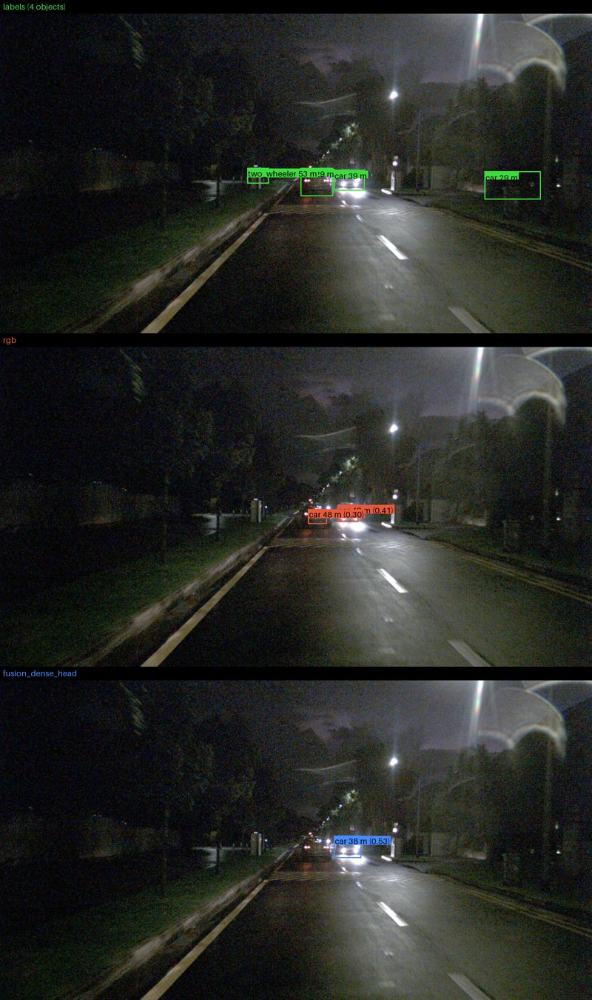
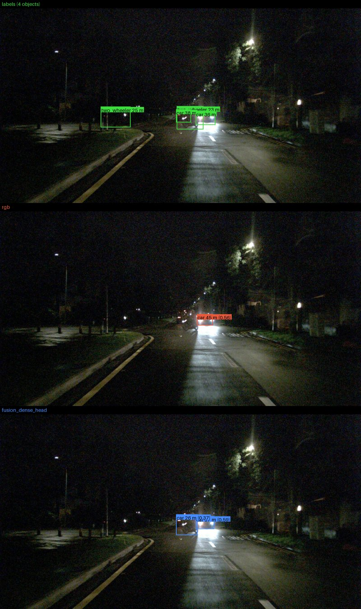
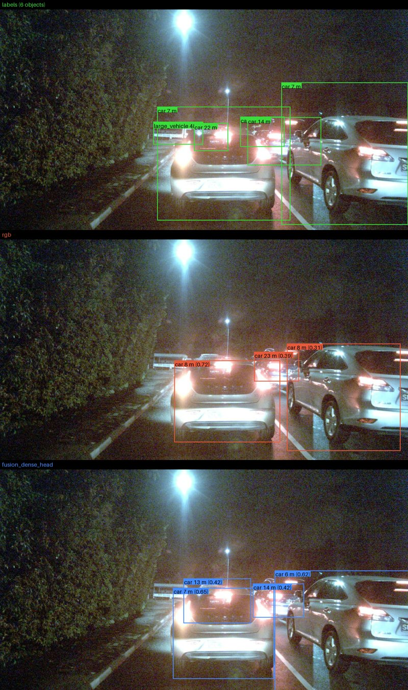
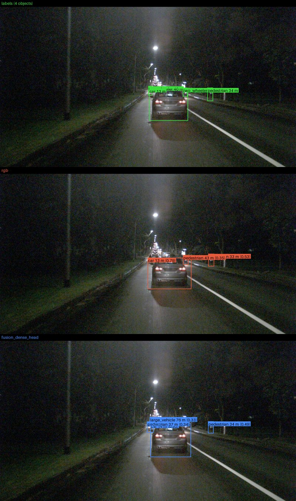
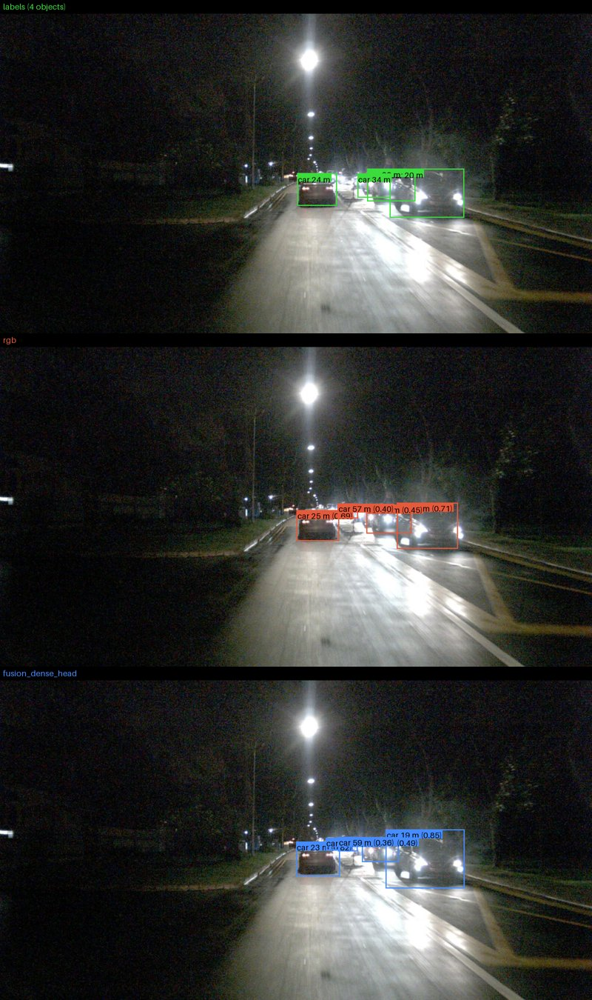

# Night frames worth looking at

43 night validation frames with at least 4 labelled objects (every 3rd/th frame), score threshold 0.3. Pictures: labels (top), rgb (middle), fusion_dense_head (bottom). Errors are the median relative distance error over matched objects.

## fusion dense head fixes distance

| picture | scene | labelled | rgb found | fusion_dense_head found | rgb err | fusion_dense_head err |
|---|---|---|---|---|---|---|
|  | scene-1073 | 5 | 2 | 3 | 34.7% | 3.7% |
|  | scene-1066 | 4 | 1 | 1 | 26.9% | 1.4% |

## both miss objects

| picture | scene | labelled | rgb found | fusion_dense_head found | rgb err | fusion_dense_head err |
|---|---|---|---|---|---|---|
|  | scene-1066 | 4 | 1 | 1 | 25.1% | 3.3% |
|  | scene-1073 | 6 | 2 | 2 | 25.2% | 7.2% |

## fusion dense head worse distance

| picture | scene | labelled | rgb found | fusion_dense_head found | rgb err | fusion_dense_head err |
|---|---|---|---|---|---|---|
|  | scene-1071 | 4 | 2 | 2 | 2.5% | 3.9% |
|  | scene-1069 | 4 | 3 | 3 | 6.0% | 5.4% |
